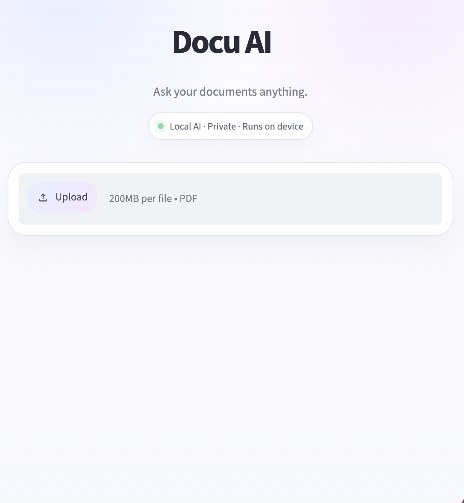
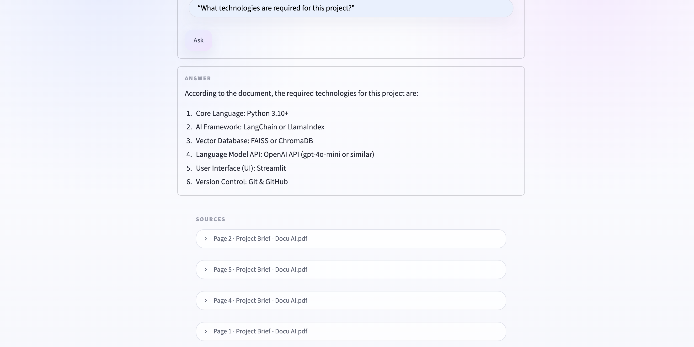
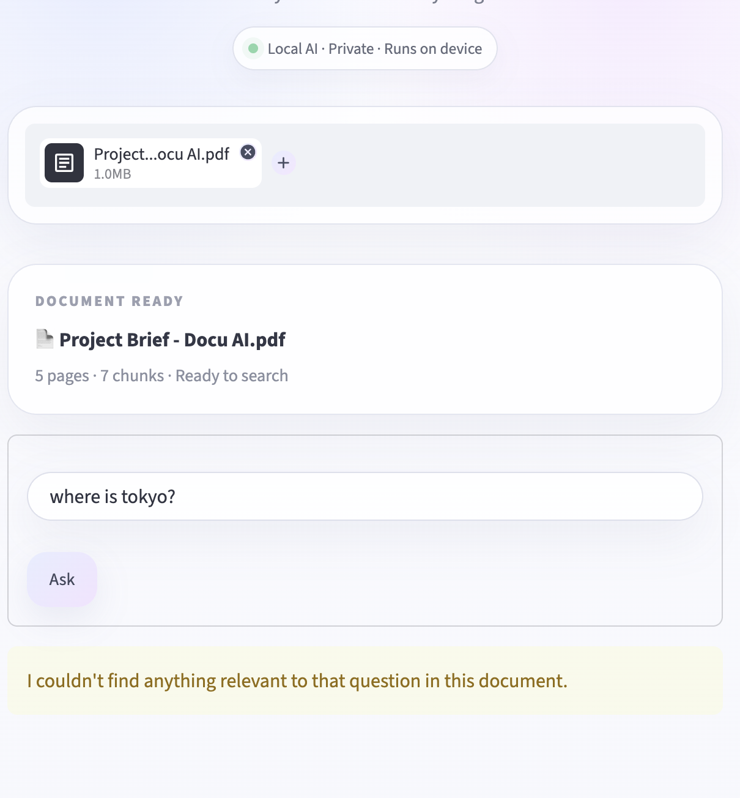

# Docu AI

Docu AI is a local Retrieval-Augmented Generation (RAG) application that lets users upload a PDF document and ask natural-language questions about its contents.

The app extracts text from the PDF, splits it into chunks, creates semantic embeddings, stores them in a vector database, retrieves the most relevant context for each question, and generates an answer using a local language model.

---

## Features

- Upload and process PDF documents
- Extract text page by page
- Split long documents into overlapping chunks
- Generate local semantic embeddings
- Store and search embeddings with ChromaDB
- Retrieve relevant document sections using semantic similarity
- Generate grounded answers using a local LLM through Ollama
- Display source document name and page number
- Deduplicate repeated sources
- Validate invalid, emoji-only, very short, very long, and unrelated questions
- Local-first workflow with no paid API required
- Clean Streamlit interface with custom styling and animations

---

## Tech Stack

- Python 3.11
- Streamlit
- LangChain
- PyPDF
- Hugging Face Sentence Transformers
- ChromaDB
- Ollama
- Llama 3.2 3B
- Git & GitHub

---

## Architecture

```text
PDF Upload
    ↓
Text Extraction
    ↓
Page Documents + Metadata
    ↓
Text Chunking
    ↓
Local Embeddings
    ↓
Chroma Vector Store
    ↓
User Question
    ↓
Input Validation
    ↓
Semantic Retrieval
    ↓
Relevance Check
    ↓
Retrieved Context
    ↓
Local LLM via Ollama
    ↓
Answer + Source Pages

## Screenshots

### Home


### Document Q&A


### Validation / Error Handling
