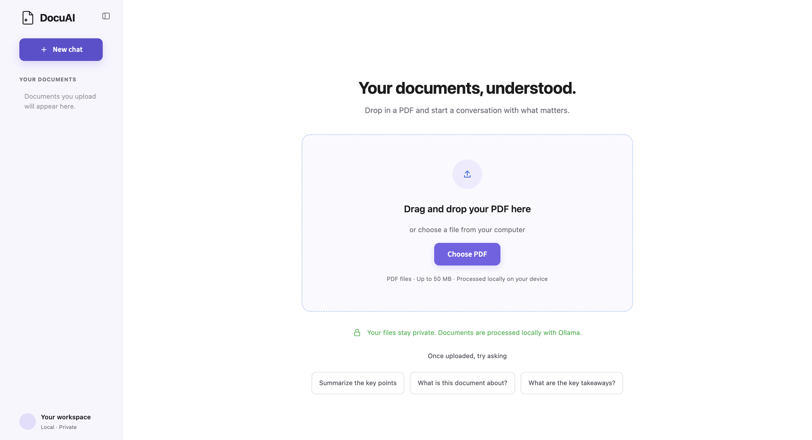
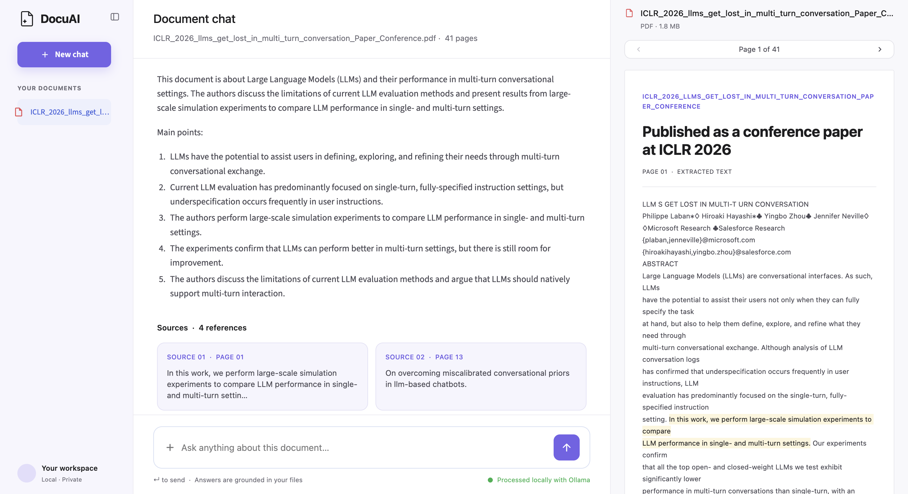
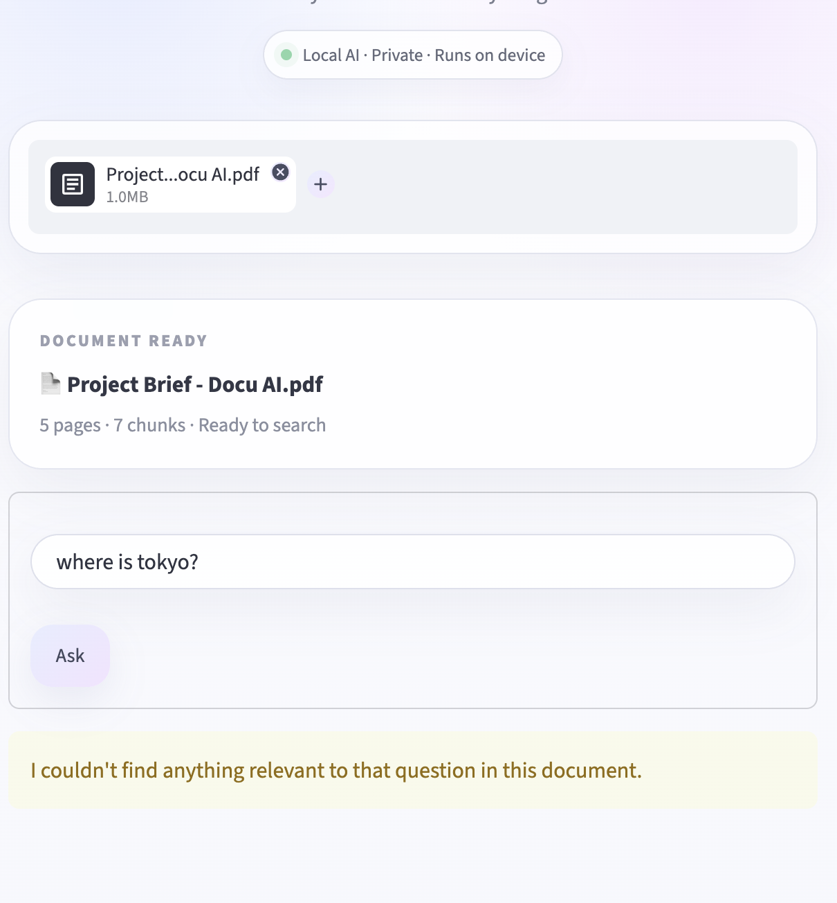

# DocuAI

DocuAI is a local-first Retrieval-Augmented Generation (RAG) application for exploring PDF documents through natural-language conversation.

Upload a PDF, ask focused questions or request a document-level summary, and get grounded answers generated locally with Ollama. DocuAI keeps source-page metadata attached to retrieved context so answers can be traced back to the document.

---

## Features

- Upload and process PDF documents locally
- Extract text page by page with source metadata
- Split long documents into overlapping chunks
- Generate semantic embeddings with Hugging Face Sentence Transformers
- Store and search embeddings with ChromaDB
- Answer focused questions using semantic retrieval
- Detect document-level intents such as summaries, key points, and takeaways
- Build representative context across the document for broad summary requests
- Generate grounded answers with a local LLM through Ollama
- Show source document and page references for retrieved evidence
- Deduplicate repeated source pages
- Validate invalid, emoji-only, very short, very long, and unsupported questions
- Handle corrupt, empty, scanned, and image-only PDFs gracefully
- Run without paid API dependencies
- Use a redesigned Streamlit interface with:
  - upload and empty state
  - document chat
  - source cards
  - right-side document preview
  - session document list
  - responsive sidebar behavior
  - local/private processing indicators

---

## Tech Stack

- Python 3.11
- Streamlit
- LangChain
- PyPDF
- Hugging Face Sentence Transformers
- ChromaDB
- Ollama
- Llama 3.2 3B
- Pytest
- GitHub Actions

---

## Architecture

```text
PDF Upload
    ↓
PDF Validation
    ↓
Text Extraction
    ↓
Page Documents + Metadata
    ↓
Text Chunking
    ↓
Local Embeddings
    ↓
Chroma Vector Store
    ↓
User Question
    ↓
Input Validation
    ↓
Query Intent Detection
    ├── Focused question → Semantic Retrieval + Relevance Check
    └── Document-level request → Representative Whole-Document Context
    ↓
Grounded Prompt
    ↓
Local LLM via Ollama
    ↓
Answer + Source Pages
```

---

## Screenshots

### Upload



### Document Chat



### Validation / Error Handling



---

## Local-First by Design

DocuAI is designed to run on the user's machine.

PDF processing, embeddings, vector retrieval, and answer generation stay local. Ollama runs the language model locally, so the core workflow does not require a paid cloud API.

This makes DocuAI useful for private document exploration and local experimentation with RAG systems.

---

## Deployment

The current version is intended for local execution rather than a standard hosted Streamlit deployment because answer generation depends on a locally running Ollama model.

A future version could optionally support cloud LLM providers while keeping the local workflow available.
