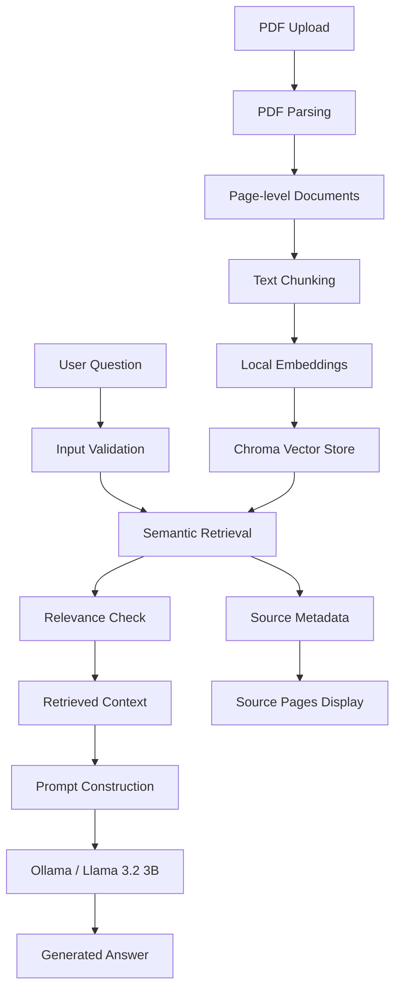

# Docu AI Architecture

## Purpose

This document describes the current data flow and responsibilities of the main components in Docu AI.

The goal is to make the PDF-to-answer pipeline understandable to another developer without requiring them to inspect the full application first.

---

## High-Level Data Flow



---

## Main Application File

The current application is primarily implemented in:

`app.py`

This file contains the Streamlit interface, PDF processing pipeline, retrieval logic, answer generation, and source rendering.

---

## 1. PDF Upload

### Responsibility

Accept a PDF file from the user through the Streamlit interface.

### Implementation

The application uses:

```python
st.file_uploader(...)
```

The uploaded file becomes the input to the document-processing pipeline.

### Main file

`app.py`

---

## 2. PDF Parsing and Text Extraction

### Responsibility

Read the uploaded PDF and extract text page by page.

### Implementation

The application uses:

```python
PdfReader(uploaded_file)
```

from PyPDF.

Each PDF page is processed individually so page-level metadata can be preserved.

### Input

Uploaded PDF file.

### Output

Extracted text grouped by PDF page.

---

## 3. Page-level Document Creation

### Responsibility

Convert extracted page text into LangChain `Document` objects.

### Implementation

The application creates:

```python
Document(
    page_content=page_text,
    metadata={
        "source": uploaded_file.name,
        "page": page_number
    }
)
```

### Metadata

Each document stores:

- source filename
- page number

This metadata is later preserved during chunking and used when displaying answer sources.

---

## 4. Text Chunking

### Responsibility

Split page-level documents into smaller overlapping chunks suitable for semantic retrieval.

### Implementation

The application uses:

```python
RecursiveCharacterTextSplitter(
    chunk_size=1000,
    chunk_overlap=200,
)
```

### Current configuration

- Chunk size: `1000`
- Chunk overlap: `200`

### Input

Page-level LangChain documents.

### Output

Smaller document chunks with preserved metadata.

---

## 5. Embedding Generation

### Responsibility

Convert document chunks into semantic vector representations.

### Responsible function

```python
get_embeddings()
```

### Implementation

The application uses:

```python
HuggingFaceEmbeddings(
    model_name="sentence-transformers/all-MiniLM-L6-v2"
)
```

### Current embedding model

`sentence-transformers/all-MiniLM-L6-v2`

### Caching

The embedding resource is cached with:

```python
@st.cache_resource
```

to avoid reloading the model on every Streamlit rerun.

---

## 6. Vector Store Creation

### Responsibility

Store embedded document chunks and support semantic similarity search.

### Responsible function

```python
get_vector_store(_documents)
```

### Implementation

The application uses Chroma:

```python
Chroma.from_documents(
    documents=_documents,
    embedding=embeddings
)
```

### Input

Chunked LangChain documents.

### Output

A Chroma vector store containing document embeddings and metadata.

---

## 7. User Question Validation

### Responsibility

Reject unsuitable input before performing semantic retrieval or generation.

The current application checks for cases including:

- very short input
- input containing only symbols or emojis
- questions longer than 500 characters

Only valid input proceeds to semantic retrieval.

---

## 8. Semantic Retrieval

### Responsibility

Retrieve document chunks that are semantically similar to the user's question.

### Implementation

The application uses:

```python
vector_store.similarity_search_with_relevance_scores(
    clean_question,
    k=5,
)
```

### Current configuration

- Retrieval method: similarity search with relevance scores
- Top-k: `5`

### Output

A list of document chunks paired with relevance scores.

---

## 9. Relevance Filtering

### Responsibility

Prevent clearly unrelated questions from being passed directly to the language model.

### Implementation

The application reads the highest retrieval score:

```python
best_score = scored_results[0][1]
```

and compares it against the current threshold:

```python
if best_score < 0.15:
```

### Current threshold

`0.15`

If the best result is below this threshold, the application displays a warning instead of generating an answer.

This threshold is currently treated as a tunable value rather than a final validated setting.

---

## 10. Context Construction

### Responsibility

Combine retrieved chunks into a context block for the language model.

### Implementation

Retrieved content is joined together while preserving page information:

```python
context = "\n\n".join(
    (
        f"[Page "
        f"{result.metadata.get('page', 'Unknown')}"
        f"]\n"
        f"{result.page_content}"
    )
    for result in results
)
```

### Output

A text context containing the retrieved chunks and their page numbers.

---

## 11. Prompt Construction

### Responsibility

Instruct the language model to answer only from the retrieved document context.

The prompt includes rules that require the model to:

- use only the provided context
- preserve the meaning and structure of the source
- avoid inventing information
- state when the answer is not found in the document

This is the main grounding mechanism used during answer generation.

---

## 12. Local Answer Generation

### Responsibility

Generate the final answer from the retrieved document context.

### Implementation

The application uses:

```python
ChatOllama(
    model="llama3.2:3b",
    temperature=0,
)
```

and invokes the model using:

```python
response = llm.invoke(prompt)
```

### Current model configuration

- Runtime: Ollama
- Model: `llama3.2:3b`
- Temperature: `0`

The model runs locally.

---

## 13. Answer Rendering

### Responsibility

Display the generated response inside the Streamlit interface.

The generated response is presented to the user after successful retrieval and model inference.

---

## 14. Source Rendering

### Responsibility

Show the document pages used during retrieval.

Source information is read from each result's metadata:

```python
result.metadata.get("source", ...)
result.metadata.get("page", ...)
```

Duplicate source/page combinations are removed before display.

The UI then exposes the retrieved source content through Streamlit expanders.

---

## End-to-End Responsibility Map

| Stage | Main responsibility | Implementation |
|---|---|---|
| Upload | Accept PDF | Streamlit |
| Parse | Read PDF pages | PyPDF |
| Document creation | Preserve page text and metadata | LangChain `Document` |
| Chunking | Split text into retrieval units | `RecursiveCharacterTextSplitter` |
| Embedding | Generate semantic vectors | Hugging Face embeddings |
| Storage | Store vectors and metadata | Chroma |
| Validation | Reject invalid questions | `app.py` validation logic |
| Retrieval | Find relevant chunks | Chroma similarity search |
| Relevance filtering | Reject weak matches | Score threshold `0.15` |
| Context building | Combine retrieved chunks | Python string construction |
| Generation | Produce grounded answer | Ollama / Llama 3.2 3B |
| Sources | Show traceable pages | Document metadata + Streamlit |

---

## Current Architecture Scope

The current architecture is designed for:

- one uploaded PDF at a time
- text-based PDFs
- local embeddings
- an in-memory Chroma vector store
- local answer generation through Ollama
- single-turn document question answering

The architecture described here reflects the current implementation and should be updated if the retrieval, storage, generation, or document-processing pipeline changes.